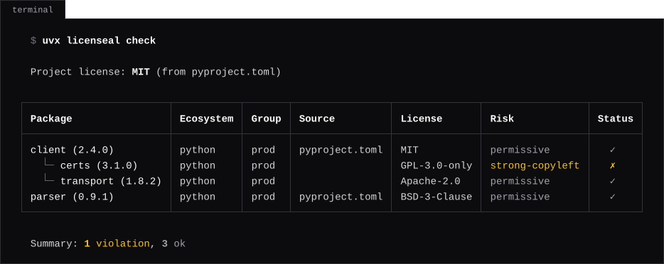
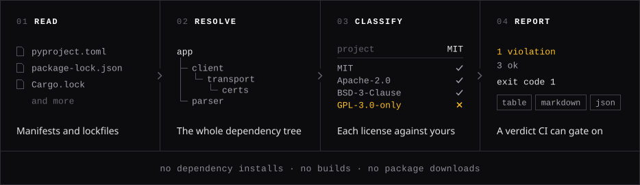

<!-- markdownlint-disable MD033 -->
<h1 align="center">
  
</h1>

<p align="center">
  <strong>Catch incompatible dependency licenses before they block a release.</strong><br>
  A verdict, not a list · Transitive across 10 ecosystems · Install-free
</p>

<p align="center">
  <a href="https://pypi.org/project/licenseal/"></a>
  <a href="https://pypi.org/project/licenseal/"></a>
  <a href="https://pepy.tech/project/licenseal"></a>
  <a href="https://github.com/shcherbak-ai/licenseal/actions/workflows/ci.yml"></a>
  <a href="https://github.com/shcherbak-ai/licenseal/actions/workflows/ci.yml"></a>
  <a href="LICENSE"></a>
</p>

<p align="center">
  <a href="#quick-start">Quick start</a> ·
  <a href="#ci-integration">CI integration</a> ·
  <a href="#how-licenseal-decides">How it decides</a> ·
  <a href="USAGE.md">Usage</a> ·
  <a href="SECURITY.md">Security model</a>
</p>

<p align="center">
  
</p>

<p align="center">Illustrative packages. The report is licenseal's own output.</p>
<!-- markdownlint-enable MD033 -->

**licenseal is a fast license compatibility checker for dependency trees across language ecosystems.** It reads manifests, lockfiles, and public registry metadata and tells you whether your dependency licenses are compatible with the license you ship under, fast enough to run in CI. It does not install dependencies, run package-manager commands, execute build scripts, or download package archives.

```bash
uvx licenseal check
```

> **Not legal advice.** licenseal automates dependency-license discovery and compatibility classification. It is a CI/audit aid, not a substitute for legal review.

## Why it matters

License non-compliance is a quiet delivery risk: it usually does not break the build, but it can block a shipment, customer approval, funding round, or acquisition when discovered late.

<!-- markdownlint-disable MD033 -->
<table>
  <tr>
    <td width="33%" valign="top"><strong>Enterprise adoption</strong><br>Security and procurement teams ask for a license report before approval.</td>
    <td width="33%" valign="top"><strong>Due diligence</strong><br>Investors and acquirers flag copyleft, source-available, or unknown licenses late.</td>
    <td width="33%" valign="top"><strong>Release timing</strong><br>A problematic dependency forces a swap or redesign when you are trying to ship.</td>
  </tr>
  <tr>
    <td valign="top"><strong>Hidden transitives</strong><br>The risky license is several levels down, pulled in by a package that looked harmless.</td>
    <td valign="top"><strong>Product obligations</strong><br>GPL, AGPL, SSPL, BUSL, and similar terms may not fit how you distribute or host.</td>
    <td valign="top"><strong>Audit trail</strong><br>Review decisions must be explicit and checked in, not buried in a spreadsheet.</td>
  </tr>
</table>
<!-- markdownlint-enable MD033 -->

licenseal turns that hidden risk into fast CI feedback: it scans the transitive dependency tree, flags compatibility issues, and records reviewed decisions for cases that need human judgment.

> [!IMPORTANT]
> In a benchmark of 50 widely used open-source repositories across ten ecosystems, licenseal flagged 485 license-compatibility issues at default settings — 405 warnings and 80 outright violations, spanning 9 of the 10 ecosystems — each a dependency whose license needed compatibility review against the project's own declared license. Inventory-only license tools surface none of these.

<!-- markdownlint-disable MD033 -->
<details>
<summary>Why this is not hypothetical</summary>

Public engineering policies and case history show why dependency-license checks matter. [Google](https://opensource.google/documentation/reference/thirdparty/licenses) and [Power](https://tech.powerhrg.com/oss-guide/docs/using/agpl.html) publish restrictive guidance for licenses such as AGPL and SSPL, while [Salesforce](https://engineering.salesforce.com/building-a-secured-data-intelligence-platform-ba85411a0c1b/) and [Uber](https://www.uber.com/us/en/blog/oss-ip/) have written about license review in production software governance. GPL enforcement cases such as [*Artifex v. Hancom*](https://artifex.com/blog/artifex-and-hancom-reach-settlement-over-ghostscript-open-source-dispute) and [*Software Freedom Conservancy v. Vizio*](https://sfconservancy.org/copyleft-compliance/vizio.html) also show that dependency-license obligations can become real delivery and legal risk.

</details>
<!-- markdownlint-enable MD033 -->

## How it works

<!-- markdownlint-disable MD033 -->
<p align="center">
  
</p>
<!-- markdownlint-enable MD033 -->

licenseal reads the manifests and lockfiles in your repository, resolves the transitive dependency tree, looks up each package's license in public registry metadata, and compares it with your project's license. You get a CI verdict, a Markdown or JSON report, and checked-in review overrides.

## Supported ecosystems

<p align="center">
  <strong>Python · JavaScript/TypeScript · Rust · Go · Java/JVM · .NET · PHP · Ruby · Elixir/Erlang · R</strong>
</p>

Supported registries include PyPI, npm, crates.io, deps.dev, proxy.golang.org, Maven Central, NuGet.org, Packagist, RubyGems, Hex, and CRAN. See [USAGE.md](USAGE.md#supported-ecosystems) for manifest and lockfile details.

## Quick start

```bash
# Run once, nothing to install
uvx licenseal check

# Install the CLI
uv tool install licenseal    # or: pipx install licenseal

# Or add it to a Python project
uv add --dev licenseal       # or: pip install licenseal
```

The exit code is non-zero when there are unreviewed violations, warnings, unknown licenses, or analysis gaps (something the scan could not read, such as a manifest without an up-to-date lockfile). Commit the lockfile, or pass `--no-require-lockfile` to accept versions estimated from the registry. See [USAGE.md](USAGE.md) for every flag and report format.

## Important defaults

| Default | Meaning |
| --- | --- |
| `--transitive` | Scans the transitive dependency tree by default. Use `--no-transitive` for direct dependencies only. |
| `--no-dev` | Dev dependencies are excluded unless `--dev` is set. |
| `--strict` | Warnings, unknown licenses, and analysis gaps fail CI in addition to violations. |
| `--require-lockfile` | A manifest without an up-to-date lockfile is an analysis gap. `--no-require-lockfile` accepts the estimated or incomplete result (estimated versions are marked `~1.2.3`), and the manifest does not fail the check. |
| Violations always fail | `--no-strict` demotes warnings, unknown licenses, and analysis gaps only; definite incompatibilities still fail. |
| Project license from the scanned directory, else `Proprietary` | Read from a manifest in the scanned directory, never from a nested package. If none declares a license, or the first that does declares a value that is not a recognised license, the project is checked as `Proprietary`: permissive dependencies pass, copyleft ones are flagged. See [USAGE.md](USAGE.md#project-license). |

## CI integration

GitHub Actions:

```yaml
# .github/workflows/licenseal.yml
name: License compatibility
on: [push, pull_request]
jobs:
  licenseal:
    runs-on: ubuntu-latest
    steps:
      - uses: actions/checkout@v4
      - uses: astral-sh/setup-uv@v6
      - run: uvx licenseal check
```

For a PR comment or audit artifact, write Markdown or JSON. The file is written even when findings or analysis gaps fail the check, so CI can publish it; the findings that failed the check are also printed to stderr:

```bash
licenseal check -f markdown -o LICENSES.md   # PR-comment-friendly audit
licenseal check -f json -o report.json       # stable machine-readable schema
```

For projects that want a checked-in audit trail, commit the generated Markdown report as `LICENSES.md`. This repository follows that convention in [LICENSES.md](LICENSES.md).

The JSON schema is documented in [JSON_OUTPUT.md](JSON_OUTPUT.md).

This repository runs the same check on itself: [](https://github.com/shcherbak-ai/licenseal/actions/workflows/licenseal.yml). To show the status in your own README:

```md
[](https://github.com/OWNER/REPO/actions/workflows/licenseal.yml)
```

## Manual review overrides

When a dependency is flagged but you have better license information than the resolver, record the reviewed license in a checked-in `licenseal.review.toml`:

```toml
[[review]]
ecosystem = "python"
package = "mystery-lib"
version = "1.0.0"
license = "MIT"
note = "reviewed packaged LICENSE file"
```

Workflow:

```bash
licenseal check -f json -o report.json                       # 1. capture flagged deps
licenseal init-review-file --from-report report.json         # 2. scaffold blank entries offline
# 3. fill in `license` and optional `note` for each entry
licenseal check                                              # 4. overrides apply
```

Reviews can only override flagged dependencies, never compatible ones. A reviewed dependency passes strict mode and stays visible with both the detected and reviewed licenses shown. An off-registry dependency is reviewed by its source instead of its version: the scaffolded entry carries a `source` line. Full review rules are in [USAGE.md](USAGE.md#manual-review-file).

## Claude Code review skill

CI can tell you which dependency licenses need attention; the bundled [Claude Code](https://claude.com/claude-code) skill helps turn those findings into documented decisions. Install it in the project being audited, then run `/licenseal-review` in Claude Code:

```bash
licenseal install-skill
```

The skill runs `licenseal check`, walks through warnings, violations, unknown licenses, and analysis gaps, and asks how your project is distributed, hosted, modified, or shipped. It fills `licenseal.review.toml` only when there is a concrete reviewable rationale, keeps genuine incompatibilities flagged, and re-runs the check so what is still flagged is explicit.

[](assets/claude_skill_qa.png)

## How licenseal decides

licenseal classifies each dependency license into a risk level and compares that risk against the project license, which it reads from a manifest in the scanned directory.

| Project \ Dependency | Permissive | Weak Copyleft | Strong Copyleft | Network Copyleft |
| --- | --- | --- | --- | --- |
| **Permissive** | OK | Warning | Violation | Violation |
| **Weak Copyleft** | OK | OK | Violation | Violation |
| **Strong Copyleft** | OK | OK | OK | Warning |
| **Network Copyleft** | OK | OK | OK | OK |

**Pair-level overrides** strengthen the matrix where two licenses are documented as legally incompatible:

- Violation: a GPLv3-family dependency (`GPL-3.0-*`, `LGPL-3.0-*`, `AGPL-3.0-*`) in a `GPL-2.0-only` project, or a `GPL-2.0-only` dependency in a `GPL-3.0-*` / `AGPL-3.0-*` project.
- Violation: `Apache-2.0` in a `GPL-2.0-only` project.
- Violation: `EPL-1.0`, `CDDL-*`, or `MPL-1.1` in any GPL-family project (`GPL-2.0-*`, `GPL-3.0-*`, `AGPL-3.0-*`).
- Warning: `EPL-2.0` in a GPL-family project, because its GPL compatibility depends on a secondary-license designation that package metadata cannot reveal.

`-or-later` forms are exempt where the upgrade clause resolves the conflict. A deprecated GNU identifier is read by its SPDX meaning: a bare `GPL-2.0` is `GPL-2.0-only`, and `GPL-2.0+` is `GPL-2.0-or-later`.

An **`OR` expression** gets the verdict of the single choice that suits the project best, each choice checked as a whole: `GPL-3.0-only OR MIT` in a `GPL-2.0-only` project is OK through its MIT choice. The report's Risk column shows the dependency's least restrictive choice. How `AND`, `WITH` exceptions, license lists, and a dual-licensed project are read is in [USAGE.md](USAGE.md#license-expressions).

With `--dev`, a violation on a dev dependency is downgraded to a warning, because dev dependencies usually do not ship with the project. A dev dependency whose license did not fully resolve is Unknown instead.

| Risk level | Examples | Meaning |
| --- | --- | --- |
| Permissive | MIT, BSD, Apache-2.0, ISC | No significant restrictions |
| Weak Copyleft | LGPL, MPL-2.0, EPL, CDDL, GPL with Classpath exception | File-scope reciprocity; linking from other files is usually allowed |
| Strong Copyleft | GPL, OSL, EUPL, CC-BY-SA | Share-alike obligations can extend to the derivative work |
| Network Copyleft | AGPL-3.0-only | Strong copyleft with network-use source-offer obligations |
| Unknown | SSPL, BUSL, Elastic, FSL, Parity, PolyForm, CC-BY-NC, CC-BY-ND, `BSD-3-Clause-No-Military-License` and the other use-restricted BSD variants, Unicode-TOU; missing or unrecognized licenses; an unrecognized `WITH` exception on a license that is not strong or network copyleft | Cannot be auto-classified; routed to manual review |

## How it compares

Comparison last reviewed: June 2026. Tool capabilities change; check each project before making a buying or compliance decision.

### CI license-compatibility workflow

| Capability | **licenseal** | [pip-licenses](https://github.com/raimon49/pip-licenses) | [license-checker](https://github.com/RSeidelsohn/license-checker-rseidelsohn) | [LicenseFinder](https://github.com/pivotal/LicenseFinder) | [fossa-cli](https://github.com/fossas/fossa-cli) |
| --- | :-: | :-: | :-: | :-: | :-: |
| **Project-license compatibility verdict** | ✓ | - | - | ~ | ~ |
| **Transitive discovery with no install or build** | ✓ | - | - | - | ~ |
| **Fast, seconds-scale CI path** | ✓ | ~ | ~ | - | - |
| **Agent-assisted flagged-finding review** | ✓ | - | - | - | - |
| **Manual review override file** | ✓ | - | ~ | ✓ | ~ |

### Coverage and artifacts

| Capability | **licenseal** | [pip-licenses](https://github.com/raimon49/pip-licenses) | [license-checker](https://github.com/RSeidelsohn/license-checker-rseidelsohn) | [LicenseFinder](https://github.com/pivotal/LicenseFinder) | [fossa-cli](https://github.com/fossas/fossa-cli) |
| --- | :-: | :-: | :-: | :-: | :-: |
| Multiple ecosystems in one tool | ✓ (10) | - | - | ✓ | ✓ |
| Dependency license report | ✓ | ✓ | ✓ | ✓ | ✓ |
| Local-only full workflow, no hosted service | ✓ | ✓ | ✓ | ✓ | - |
| Offline operation | - | ✓ | ✓ | ~ | - |
| Standards SBOM export (CycloneDX / SPDX) | - | - | - | - | ✓ |

`✓` supported · `~` partial · `-` not supported

No tool clears every row. The discovery row is about source-tree analysis: manifests, lockfiles, and registry metadata before a successful package-manager install is assumed. Some tools can produce broader inventories after installation or hosted analysis; licenseal is optimized for transitive dependency coverage in CI without that prerequisite. `~` means the capability exists, but with a different workflow, hosted service, package-manager prerequisite, or policy model. The speed row reflects benchmark runs on public repositories, not a vendor guarantee. Pair licenseal with an SBOM generator, hosted compliance platform, or installed-metadata scanner when those are the artifacts or workflows you need.

## Scope

licenseal is intentionally narrow:

- It is a **license compatibility checker**, not a legal approval workflow or policy-exception manager.
- It checks **published dependency license metadata**, not vulnerability status, provenance, or SBOM completeness.
- It reads **manifests, lockfiles, and public registry metadata endpoints** only. A package pinned to a private registry is looked up on the public one by name (see [SECURITY.md](SECURITY.md#what-leaves-the-process)).
- An **off-registry dependency**, installed from a git repository, a direct URL, or a path the scan does not read (outside the scanned directory, an archive, a vendored or excluded directory), has no registry record. It is reported as `UNKNOWN` with its source, nothing is requested or downloaded for it, and a review keyed on that source records its license (see [USAGE.md](USAGE.md#off-registry-dependencies)).
- It does not infer dependency licenses by pattern-matching local `LICENSE` files or source comments; missing structured metadata is reported as `UNKNOWN` and routed to manual review.
- It produces Markdown/JSON dependency license reports, but not standards-compliant CycloneDX or SPDX SBOMs; use a dedicated SBOM tool when you need that artifact.
- Manual review can override flagged findings when a maintainer has better information, but the review file is an audit record, not hidden legal sign-off.

The full trust boundary and network allowlist are documented in [SECURITY.md](SECURITY.md).

[](https://github.com/shcherbak-ai/licenseal/actions/workflows/codeql.yml)
[](https://github.com/PyCQA/bandit)
[](https://github.com/shcherbak-ai/tethered)

## Learn more

- **[USAGE.md](USAGE.md)** - full CLI reference, transitive-resolution behavior, per-ecosystem detail, review-file rules, and the Claude Code skill
- **[SECURITY.md](SECURITY.md)** - the manifest-and-registry trust boundary and exact network-egress allowlist
- **[JSON_OUTPUT.md](JSON_OUTPUT.md)** - stable machine-readable schema
- **[CHANGELOG.md](CHANGELOG.md)** - what changed in each release, and how to upgrade

## Contributing

See [CONTRIBUTING.md](CONTRIBUTING.md) for development setup and guidelines.

If licenseal helps your project, star ⭐ this repo to help other teams find it too.

[](https://github.com/astral-sh/ruff)
[](https://github.com/astral-sh/uv)
[](https://github.com/astral-sh/ty)

## License

[Apache-2.0](LICENSE). See [`LICENSE`](LICENSE) for the full text and [`NOTICE`](NOTICE) for attribution.

## More from shcherbak_ai

| Project | What it does |
| --- | --- |
| 💎 [ContextGem](https://github.com/shcherbak-ai/contextgem) | Structured extraction from documents with LLMs. |
| 🪁 [tethered](https://github.com/shcherbak-ai/tethered) | Network egress control for CLI tools and agent workflows. |

## Connect

Questions or collaboration ideas? Reach out on [LinkedIn](https://www.linkedin.com/in/sergii-shcherbak-10068866/) or [X](https://x.com/seshch).

Built with ❤️ in Oslo, Norway.
