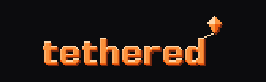

<!-- markdownlint-disable MD033 -->
<h1 align="center">
  
</h1>

<p align="center">
  <strong>Catch incompatible dependency licenses before they block a release.</strong><br>
  A verdict, not a list · Transitive across 10 ecosystems · No dependency installs · <a href="#claude-code-review-skill">Claude Code review skill</a>
</p>

<p align="center">
  <a href="https://pypi.org/project/licenseal/"></a>
  <a href="https://pypi.org/project/licenseal/"></a>
  <a href="https://pepy.tech/project/licenseal"></a>
  <a href="https://github.com/shcherbak-ai/licenseal/actions/workflows/ci.yml"></a>
  <a href="https://github.com/shcherbak-ai/licenseal/actions/workflows/ci.yml"></a>
  <a href="LICENSE"></a>
</p>

<p align="center">
  <a href="#quick-start">Quick start</a> ·
  <a href="#ci-integration">CI integration</a> ·
  <a href="#how-licenseal-decides">How it decides</a> ·
  <a href="https://shcherbak-ai.github.io/licenseal/">Documentation</a> ·
  <a href="https://shcherbak-ai.github.io/licenseal/security/">Security model</a>
</p>

<p align="center">
  
</p>

<p align="center">Illustrative packages. The report is licenseal's own output.</p>
<!-- markdownlint-enable MD033 -->

**licenseal is a fast license compatibility checker for dependency trees across language ecosystems.** It reads manifests, lockfiles, and public registry metadata and tells you whether your dependency licenses are compatible with the license you ship under, fast enough to run in CI. It does not install dependencies, run package-manager commands, execute build scripts, or download package archives.

```bash
uvx licenseal check
```

> **Not legal advice.** licenseal automates dependency-license discovery and compatibility classification. It is a CI/audit aid, not a substitute for legal review.

## Why it matters

License non-compliance is a quiet delivery risk: it usually does not break the build, but it can block a shipment, customer approval, funding round, or acquisition when discovered late.

<!-- markdownlint-disable MD033 -->
<table>
  <tr>
    <td width="33%" valign="top"><strong>Enterprise adoption</strong><br>Security and procurement teams ask for a license report before approval.</td>
    <td width="33%" valign="top"><strong>Due diligence</strong><br>Investors and acquirers flag copyleft, source-available, or unknown licenses late.</td>
    <td width="33%" valign="top"><strong>Release timing</strong><br>A problematic dependency forces a swap or redesign when you are trying to ship.</td>
  </tr>
  <tr>
    <td valign="top"><strong>Hidden transitives</strong><br>The risky license is several levels down, pulled in by a package that looked harmless.</td>
    <td valign="top"><strong>Product obligations</strong><br>GPL, AGPL, SSPL, BUSL, and similar terms may not fit how you distribute or host.</td>
    <td valign="top"><strong>Audit trail</strong><br>Review decisions must be explicit and checked in, not buried in a spreadsheet.</td>
  </tr>
</table>
<!-- markdownlint-enable MD033 -->

> [!NOTE]
> In a benchmark of 50 widely used open-source repositories across ten ecosystems, licenseal flagged 485 license-compatibility issues at default settings — 405 warnings and 80 outright violations, spanning 9 of the 10 ecosystems — each a dependency whose license needed compatibility review against the project's own declared license. Inventory-only license tools surface none of these.

<!-- markdownlint-disable MD033 -->
<details>
<summary>Why this is not hypothetical</summary>

Public engineering policies and case history show why dependency-license checks matter. [Google](https://opensource.google/documentation/reference/thirdparty/licenses) and [Power](https://tech.powerhrg.com/oss-guide/docs/using/agpl.html) publish restrictive guidance for licenses such as AGPL and SSPL, while [Salesforce](https://engineering.salesforce.com/building-a-secured-data-intelligence-platform-ba85411a0c1b/) and [Uber](https://www.uber.com/us/en/blog/oss-ip/) have written about license review in production software governance. GPL enforcement cases such as [*Artifex v. Hancom*](https://artifex.com/blog/artifex-and-hancom-reach-settlement-over-ghostscript-open-source-dispute) and [*Software Freedom Conservancy v. Vizio*](https://sfconservancy.org/copyleft-compliance/vizio.html) also show that dependency-license obligations can become real delivery and legal risk.

</details>
<!-- markdownlint-enable MD033 -->

## How it works

<!-- markdownlint-disable MD033 -->
<p align="center">
  
</p>
<!-- markdownlint-enable MD033 -->

licenseal reads the manifests and lockfiles in your repository, resolves the transitive dependency tree, looks up each package's license in public registry metadata, and compares it with your project's license. You get a CI verdict, a Markdown or JSON report, and checked-in review overrides.

## Supported ecosystems

<p align="center">
  
  
  
  
  
  
  
  
  
  
</p>

The manifests, lockfiles, and registries read for each are listed under [Supported ecosystems](https://shcherbak-ai.github.io/licenseal/ecosystems/).

## Quick start

```bash
# Run once, without installing licenseal
uvx licenseal check

# Install the CLI
uv tool install licenseal    # or: pipx install licenseal

# Or add it to a Python project
uv add --dev licenseal       # or: pip install licenseal
```

The exit code is non-zero when there are unreviewed violations, warnings, unknown licenses, or analysis gaps (something the scan could not read, such as a manifest without an up-to-date lockfile). Commit the lockfile, or pass `--no-require-lockfile` to accept versions estimated from the registry.

Defaults worth knowing:

- The whole dependency tree is scanned, without dev dependencies. `--no-transitive` scans direct dependencies only; `--dev` adds dev dependencies.
- Violations always fail. Warnings, unknown licenses, and analysis gaps fail too, unless you pass `--no-strict`.
- The project license is read from a manifest in the scanned directory, never from a nested package. If that does not give a recognised license, the project is checked as `Proprietary`: permissive dependencies pass, copyleft ones are flagged ([details](https://shcherbak-ai.github.io/licenseal/concepts/project-license/)).

Every flag is in the [CLI reference](https://shcherbak-ai.github.io/licenseal/reference/cli/).

## CI integration

```yaml
# .github/workflows/licenseal.yml
name: License compatibility
on: [push, pull_request]
jobs:
  licenseal:
    runs-on: ubuntu-latest
    steps:
      - uses: actions/checkout@v7
      - uses: astral-sh/setup-uv@v10.3.0
      - run: uvx licenseal check
```

For a PR comment or an audit trail, write a report with `-f markdown -o LICENSES.md` or `-f json -o report.json` ([schema](https://shcherbak-ai.github.io/licenseal/reference/json-report/)). The file is written even when findings or analysis gaps fail the check, so CI can publish it. This repository commits its own report as [LICENSES.md](LICENSES.md).

## Reviewing findings

When a dependency is flagged but you have better license information than the scan found, record the reviewed license in a checked-in `licenseal.review.toml`. `licenseal init-review-file` scaffolds an entry for each flagged dependency. A review can only override a flagged dependency, and a reviewed dependency stays in the report with both its detected and its reviewed license. The workflow, the file format, and its rules are in [Review flagged dependencies](https://shcherbak-ai.github.io/licenseal/guides/review-findings/).

### Claude Code review skill

CI can tell you which dependency licenses need attention; the bundled [Claude Code](https://claude.com/claude-code) skill helps turn those findings into documented decisions. Install it in the project being audited, then run `/licenseal-review` in Claude Code:

```bash
licenseal install-skill
```

The skill runs `licenseal check`, walks through warnings, violations, unknown licenses, and analysis gaps, and asks how your project is distributed, hosted, modified, or shipped. It fills `licenseal.review.toml` only when there is a concrete reviewable rationale, keeps genuine incompatibilities flagged, and re-runs the check so what is still flagged is explicit.

[](docs/assets/claude-skill-question.png)

## How licenseal decides

licenseal gives each dependency license a risk level and compares it with your project's license:

| Project \ Dependency | Permissive | Weak Copyleft | Strong Copyleft | Network Copyleft |
| --- | --- | --- | --- | --- |
| **Permissive** | OK | Warning | Violation | Violation |
| **Weak Copyleft** | OK | OK | Violation | Violation |
| **Strong Copyleft** | OK | OK | OK | Warning |
| **Network Copyleft** | OK | OK | OK | OK |

MIT, BSD, and Apache-2.0 are permissive; LGPL, MPL-2.0, and EPL are weak copyleft; GPL is strong copyleft; AGPL is network copyleft. A license that cannot be classified, such as a source-available one, or a package with no license metadata, is Unknown and goes to manual review. The rules for specific license pairs, for `OR` / `AND` / `WITH` expressions, and for dev dependencies are in [How licenseal decides](https://shcherbak-ai.github.io/licenseal/concepts/verdicts/).

## How it compares

Comparison last reviewed: June 2026. Tool capabilities change; check each project before making a buying or compliance decision.

| Capability | **licenseal** | [pip-licenses](https://github.com/raimon49/pip-licenses) | [license-checker](https://github.com/RSeidelsohn/license-checker-rseidelsohn) | [LicenseFinder](https://github.com/pivotal/LicenseFinder) | [fossa-cli](https://github.com/fossas/fossa-cli) |
| --- | :-: | :-: | :-: | :-: | :-: |
| Project-license compatibility verdict | ✓ | - | - | ~ | ~ |
| Transitive discovery, no dependency install or build | ✓ | - | - | - | ~ |
| Fast, seconds-scale CI path | ✓ | ~ | ~ | - | - |
| Agent-assisted flagged-finding review | ✓ | - | - | - | - |
| Manual review override file | ✓ | - | ~ | ✓ | ~ |
| Multiple ecosystems in one tool | ✓ (10) | - | - | ✓ | ✓ |
| Local-only full workflow, no hosted service | ✓ | ✓ | ✓ | ✓ | - |
| Offline operation | - | ✓ | ✓ | ~ | - |
| Standards SBOM export (CycloneDX / SPDX) | - | - | - | - | ✓ |

`✓` supported · `~` partial · `-` not supported

No tool clears every row. The discovery row is about source-tree analysis: manifests, lockfiles, and registry metadata before a successful package-manager install is assumed. Some tools can produce broader inventories after installation or hosted analysis. `~` means the capability exists, but with a different workflow, hosted service, package-manager prerequisite, or policy model. The speed row reflects benchmark runs on public repositories, not a vendor guarantee. Pair licenseal with an SBOM generator, hosted compliance platform, or installed-metadata scanner when those are the artifacts or workflows you need.

## Scope

licenseal is intentionally narrow:

- It is a **license compatibility checker**, not a legal approval workflow, a vulnerability scanner, or an SBOM generator.
- It reads **manifests, lockfiles, and public registry metadata** only. A package pinned to a private registry is looked up on the public one by name ([what leaves the process](https://shcherbak-ai.github.io/licenseal/security/data-sent/)). A dependency installed from git, a URL, or a path the scan does not read is reported as `UNKNOWN`, and nothing is requested for it ([off-registry dependencies](https://shcherbak-ai.github.io/licenseal/concepts/off-registry/)).
- It does not infer licenses from `LICENSE` files or source comments: missing structured metadata is `UNKNOWN` and goes to manual review.
- A review records a maintainer's decision. It is an audit record, not legal sign-off.

The trust boundary and the network allowlist are in the [security model](https://shcherbak-ai.github.io/licenseal/security/).

## Documentation

The documentation is at **[shcherbak-ai.github.io/licenseal](https://shcherbak-ai.github.io/licenseal/)**:

- [Quick start](https://shcherbak-ai.github.io/licenseal/get-started/quick-start/) and [reading the report](https://shcherbak-ai.github.io/licenseal/get-started/read-the-report/)
- [Run it in CI](https://shcherbak-ai.github.io/licenseal/guides/ci/) and [fix a failing check](https://shcherbak-ai.github.io/licenseal/guides/fix-a-failing-check/)
- [What fails a check](https://shcherbak-ai.github.io/licenseal/concepts/check-failures/) and [how licenseal decides](https://shcherbak-ai.github.io/licenseal/concepts/verdicts/)
- [Supported ecosystems](https://shcherbak-ai.github.io/licenseal/ecosystems/), with a page for each
- [CLI reference](https://shcherbak-ai.github.io/licenseal/reference/cli/) and the [JSON report](https://shcherbak-ai.github.io/licenseal/reference/json-report/)
- [Security model](https://shcherbak-ai.github.io/licenseal/security/): what is read, which hosts are contacted, and what is sent
- [Changelog](https://shcherbak-ai.github.io/licenseal/changelog/)

## Contributing

See [CONTRIBUTING.md](CONTRIBUTING.md) for development setup and guidelines. If licenseal helps your project, star ⭐ this repo to help other teams find it too.

## License

[Apache-2.0](LICENSE). See [`LICENSE`](LICENSE) for the full text and [`NOTICE`](NOTICE) for attribution.

## More from shcherbak_ai

<!-- markdownlint-disable MD033 -->
<table>
  <tr>
    <td width="50%" align="center" valign="top">
      <a href="https://github.com/shcherbak-ai/contextgem"></a><br>
      Structured extraction from documents with LLMs.
    </td>
    <td width="50%" align="center" valign="top">
      <a href="https://github.com/shcherbak-ai/tethered"></a><br>
      Network egress control for CLI tools and agent workflows.
    </td>
  </tr>
</table>
<!-- markdownlint-enable MD033 -->

Questions or collaboration ideas? Reach out on [LinkedIn](https://www.linkedin.com/in/sergii-shcherbak-10068866/) or [X](https://x.com/seshch). Built with ❤️ in Oslo, Norway.
