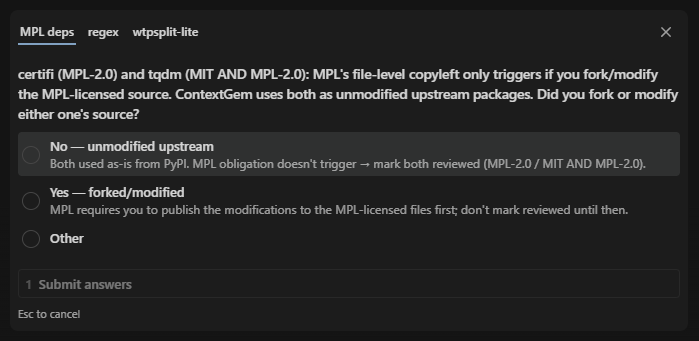

# { .home-name width="416" }

<p class="home-lead">Catch incompatible dependency licenses before they block a release.</p>

A verdict, not a list · Transitive across 10 ecosystems · No dependency installs · [Claude Code review skill](guides/claude-code-skill.md)
{ .home-points }

licenseal reads manifests (`pyproject.toml`, `package.json`, and the like), lockfiles, and public registry metadata and tells you whether your dependency licenses are compatible with the license you ship under, fast enough to run in CI. It does not install dependencies, run package-manager commands, execute build scripts, or download package archives.

```bash
uvx licenseal check
```

<figure markdown>

<figcaption>Illustrative packages. The report is licenseal's own output.</figcaption>
</figure>

The check says which licenses need attention. The bundled [Claude Code skill](guides/claude-code-skill.md) walks you through each finding and records your decisions in a checked-in file:

```bash
licenseal install-skill   # then run /licenseal-review in Claude Code
```

<figure markdown>
{ .screenshot }
</figure>

<div class="grid cards" markdown>

- **[Quick start](get-started/quick-start.md)**

    Run the first scan and learn what makes a check fail.

- **[Run it in CI](guides/ci.md)**

    One command in a workflow. Commit your lockfiles and publish the report.

- **[Fix a failing check](guides/fix-a-failing-check.md)**

    What to do about a violation, a warning, an unknown license, or an analysis gap.

- **[Review flagged dependencies](guides/review-findings.md)**

    Record a decision in a checked-in file, by hand or with the Claude Code skill.

- **[How licenseal decides](concepts/verdicts.md)**

    The compatibility matrix and the rules behind every verdict.

- **[Supported ecosystems](ecosystems/index.md)**

    Python, JavaScript and TypeScript, Rust, Go, Java and the JVM, .NET, PHP, Ruby, Elixir and Erlang, and R.

- **[Security model](security/index.md)**

    What is read, which hosts are contacted, and what is sent to them.

- **[CLI reference](reference/cli.md)**

    Every command and option, with defaults and exit codes.

</div>

> [!NOTE]
> **Not legal advice.** licenseal automates dependency-license discovery and compatibility classification. It is a CI/audit aid, not a substitute for legal review.
